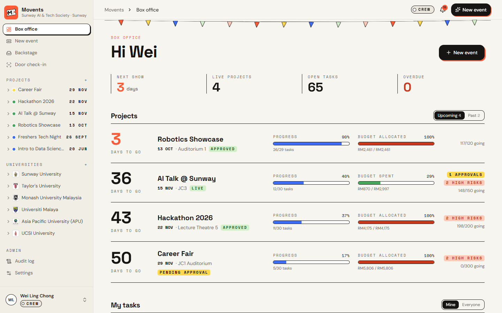
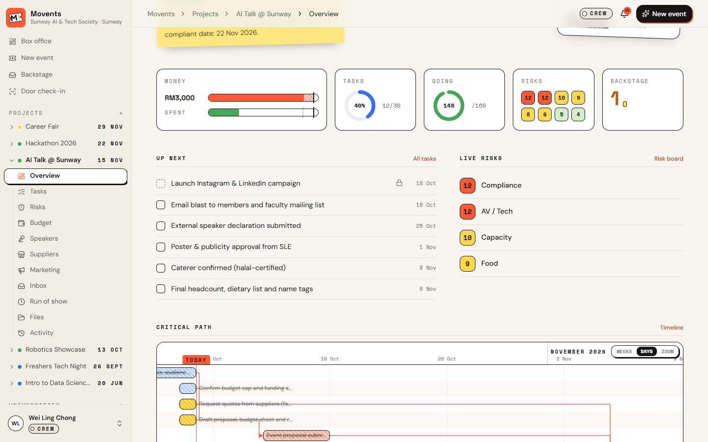
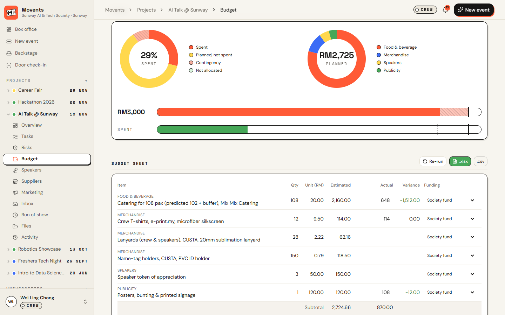
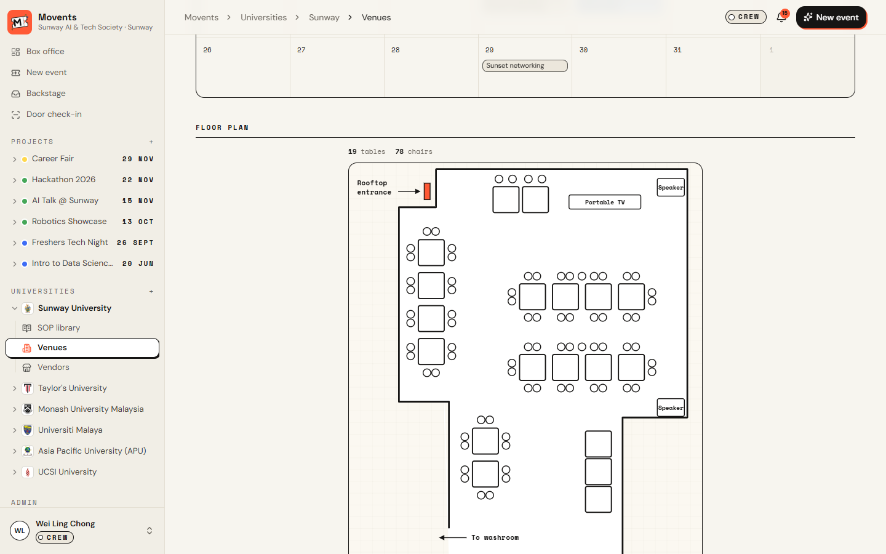
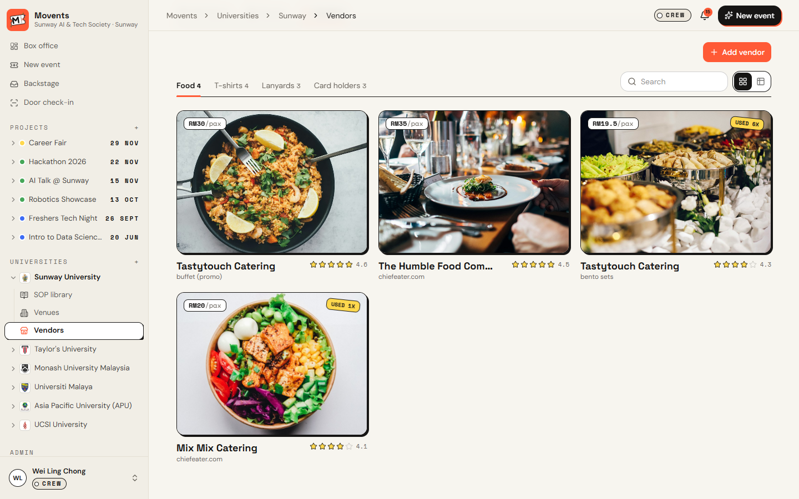

<p align="center">
  
</p>

<h1 align="center">Movents</h1>

<p align="center"><b>Tell WorkBuddy the event. Movents plans the rest.</b><br/>
Campus event planning for university societies, driven end to end by Tencent WorkBuddy.</p>

<p align="center">
  <a href="https://movents.vercel.app"><b>Live app</b></a> ·
  <a href="https://github.com/ZenBen5173/movents"><b>GitHub</b></a> ·
  <a href="docs/Movents-Pitch-Deck.pdf"><b>Slides (PDF)</b></a> ·
  <a href="pitch-video/out/movents-pitch-90s-small.mp4"><b>Pitch video</b></a>
</p>



## Submission

| | |
|---|---|
| **Group name** | _TBC_ |
| **Campus branch** | Taylor's University |
| **Track** | Dormathon 2026, Track 2 (Tencent WorkBuddy) |
| **GitHub repository** | https://github.com/ZenBen5173/movents |
| **Deployed application** | https://movents.vercel.app |
| **Presentation slides (PDF)** | [docs/Movents-Pitch-Deck.pdf](docs/Movents-Pitch-Deck.pdf) |
| **Pitch video (1:30)** | [pitch-video/out/movents-pitch-90s-small.mp4](pitch-video/out/movents-pitch-90s-small.mp4) |

<p align="center"><br/><sub>Scan to open the live app</sub></p>

---

## The problem

Student societies run campus events on spreadsheets, chat threads and guesswork. Every university has its own
approval chain, lead times and paperwork, so committees miss deadlines, go over budget and redo the same work every
semester.

## What Movents does

One message to WorkBuddy becomes a fully planned event. Give it the idea, date, headcount, budget, who is helping and
any suppliers you want. Through the Movents MCP server it plans everything the way your university's SOP requires:

1. **Plan:** reads the university SOP and lessons from past events, then works the timeline back from the SOP deadlines, with task dependencies.
2. **Research:** searches the web for speakers and supplier quotes (food, T-shirts, lanyards, card holders).
3. **Budget:** composes a budget with 10% contingency and adapts it (cheaper suppliers, then cuts) until it fits the cap.
4. **Draft:** proposal in the SOP's format (PDF and Word), risk register with a weather plan, run of show, crew roster and a marketing kit.
5. **Check:** budget within cap, every SOP section present, lead times met, venue free of clashes.
6. **Act, with approval:** speaker invites, supplier quote requests, budget sign off, faculty submission, Luma and Meetup pages. Anything a member is not allowed to do goes to the right approver first, and every action is logged.
7. **Close out:** after the event, the post-event report and lessons learned feed straight into the next plan.

Many events can be planned at once, each private to its own team.

## A look inside

| Project overview | Timeline with dependencies |
|---|---|
|  |  |
| **Budget with spend charts** | **Speakers** |
|  |  |
| **Backstage approvals** | **Venue floor plan** |
|  |  |
| **University vendor list** | |
|  | |

## Features

**Projects**
- Box office dashboard: countdown, progress, budget and risks for every event, plus your tasks grouped by event.
- Event teams: only people added to an event can see and edit it (President, VP and faculty advisor see all).
- Tasks as a list, board or Gantt timeline with dependencies and the critical path.
- Risks: 5x5 heat map and a compact register with mitigation tasks.
- Budget: donut charts, live budget sheet, 90% spend alert, swap suppliers with one click.
- Speakers as lanyard passes with profile documents; suppliers with quote, contract and deposit tracking.
- Registration with Luma and Meetup sync, public sign-up page, waitlist, and QR door check-in with tabs.
- Marketing kit: poster, Instagram and LinkedIn posts with captions (Nano Banana via WorkBuddy).
- Per-event inbox, run of show timetable, editable crew roles, project lead and co-lead contacts.
- Files in folders: proposal, budget, risk register, run sheet, calendar feed, post-event report.

**Universities**
- SOP library with the approval chain, lead times, templates (pre-event proposal, post-event report, speaker profile) and budget rules explained on hover.
- Venues with photos, search, a monthly booking calendar and floor plans.
- Approved vendor list with photos, prices and ratings from past events.
- Six universities seeded: Sunway, Taylor's, Monash Malaysia, Universiti Malaya, APU and UCSI.

**Governance**
- Role-based approvals (Backstage) with full detail before you approve, faculty approval by signed link, and an audit log.

## Using it with WorkBuddy

Movents exposes an MCP server at `https://movents.vercel.app/api/mcp`. In the app, open **Settings**, copy the MCP
config (it includes your API key) into WorkBuddy, and add the skill in [`workbuddy/skills/movents`](workbuddy/skills/movents/SKILL.md).
Then ask WorkBuddy something like:

> Plan a 150-pax AI talk at Sunway on 15 Nov, budget RM3,000, with Priya, Jason and Arjun. Use Mix Mix Catering for food.

## Roles

| Role | Can do without approval |
|---|---|
| President / VP | Everything |
| Director | Speaker and supplier emails, approvals for their own department, budget up to the SOP limit |
| Committee member | Drafts, plans and internal calendar. Everything outbound goes to Backstage for approval |
| Faculty advisor | Approves or rejects the proposal from the emailed link |

Switch accounts from the bottom of the sidebar to see each role.

## Run locally

```bash
npm install
npm run dev
```

Open http://localhost:3000. No keys are needed: every integration has a demo mode, and demo data (six universities,
eight events at every stage) is created on first load. Copy `.env.example` to `.env.local` to turn real
integrations on (Outlook or Resend email, Google Calendar, Luma, Meetup, Stripe test mode, Gemini).

## Stack

Next.js 15 (App Router), React 19, Tailwind CSS 4, PGlite (embedded Postgres) or any Postgres via `DATABASE_URL`,
MCP over Streamable HTTP, `docx`, `pdf-lib` and `exceljs` for documents, Remotion for the pitch video.

## Deploy

Deployed on Vercel. Without `DATABASE_URL` each instance starts from the demo snapshot in `snapshot/` (rebuild it with
`node scripts/snapshot-db.mjs`). Set `DATABASE_URL` for persistent data, plus `APP_SECRET` and `CRON_SECRET`.
`vercel.json` schedules the daily automation (follow-ups, reminders, spend alerts).

## Tests

```bash
npm test
```

Planning engine, budget adapt loop, lead time checks, venue clashes, run sheet, NPS, roles table, SOP parser, team
and supplier parsing from the brief.
